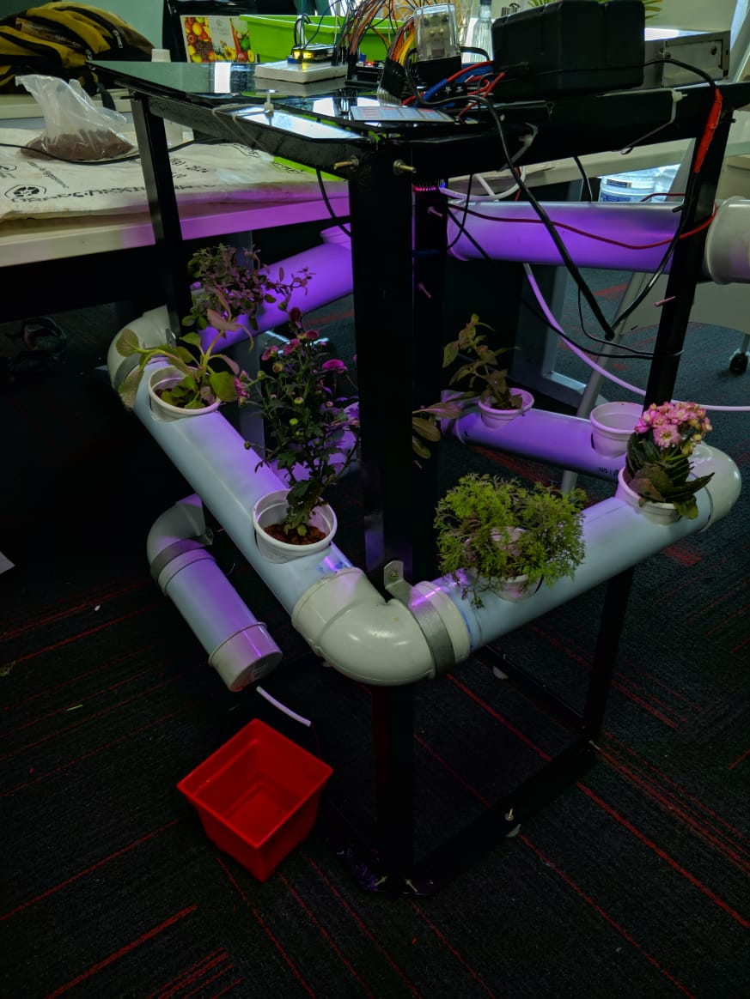

# 🌱 Automated Hydroponics System

**Hydroponinator**  
**Makeathon 4.0 | Lema Labs**

We developed a compact, fully functional hydroponics system that creates optimal growing conditions for plants—completely without soil.

---

## 🛠️ System Overview

Our system is programmed using the **Arduino IDE**, and built around the **Arduino MEGA 2560** microcontroller. It incorporates a range of sensors and actuators to monitor and maintain the perfect environment for plant growth.

### 🔧 Hardware Components

- **Arduino MEGA 2560**
- **4x4 Keypad** – User input interface  
- **16x2 LCD Display** – System feedback and status display  
- **DHT11 Sensor** – Temperature and humidity sensing  
- **pH Sensor** – Monitors nutrient solution pH  
- **Water Level Sensor** – Ensures reservoir levels are optimal  
- **All-Spectrum Grow Light**  
- **Fluorescent Lights**  
- **40W Submersible Water Pump**  
- **Mini Sump Motors**  
- **Custom Humidifier** – Controls ambient humidity  
- **Large Water & Mineral Reservoirs**  
- **Custom Powder-Coated Aluminum Frame with Angled PVC Channels** – Ensures efficient water flow

---

## 🌿 Features

- **Automated pH Balancing** – Adjusts pH levels by dispensing minerals from dedicated reservoirs  
- **Lighting Control** – Timed or sensor-based artificial lighting for optimal photosynthesis  
- **Humidity Regulation** – Maintains required humidity using a custom-built humidifier  
- **Compact Design** – Space-efficient build suitable for indoor use  
- **Multi-Mode Operation**:
  - 🔁 **Automatic Mode** – Fully autonomous operation  
  - ✋ **Manual Mode** – User-controlled via keypad  
  - ⚡ **Economy Mode** – Reduced power and water usage for sustainability

---

## 🧪 Applications

This system supports the growth of various hydroponics-compatible plants when provided with the right nutrients. It's ideal for:

- Indoor urban farming  
- Home gardening  
- Educational and research purposes

✅ **Project verified by Lema Labs**

**© Hydroponinator Team | Makeathon 4.0**
